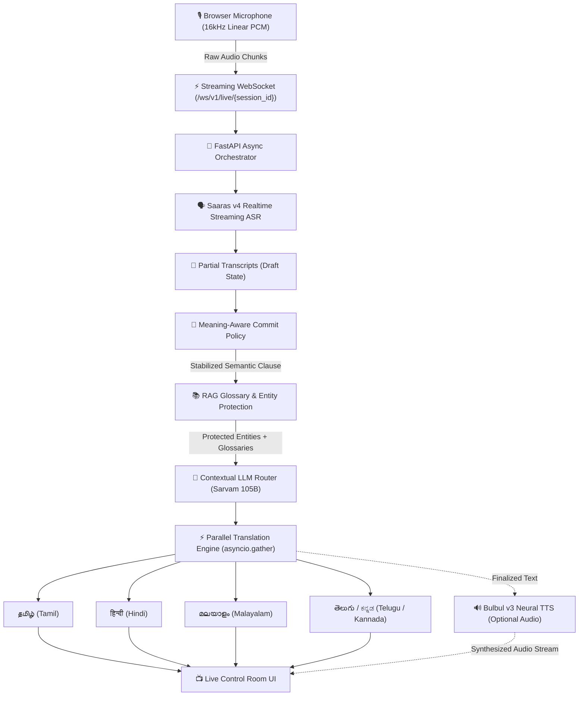

# IndicLive — Real-Time Indic Language Translation Intelligence Platform

[](https://github.com/Jeevahan08/Hacknex/actions)
[](file:///backend)
[](file:///frontend)
[](file:///backend)
[](file:///frontend)
[](file:///LICENSE)

> **"Speak Naturally. Understand Instantly."**  
> *Real-time speech translation and intelligence platform built for India's multilingual conversations.*

---

## 1. Executive Summary

**IndicLive** is a high-performance, real-time speech-to-speech and speech-to-text translation intelligence platform engineered specifically for India’s diverse multilingual communication landscape. Rather than functioning as a standard conversational chatbot or a conventional batch translation tool, IndicLive operates as an interactive live translation control room designed to handle low-latency streaming audio while preserving linguistic nuance, colloquial code-mixing, and cultural context.

At its core, the platform integrates real-time streaming Automatic Speech Recognition (ASR) powered by Saaras v4 with high-fidelity neural translation engines and Bulbul v3 speech synthesis. To solve the fundamental challenges of live speech translation—such as mid-sentence meaning shifts, context drift, and translation jitter—IndicLive incorporates advanced **Large Language Model (LLM)** intelligence using Sarvam 105B alongside purpose-built **Retrieval-Augmented Generation (RAG)** modules.

The **RAG module** dynamically retrieves domain-specific terminology, contextual glossaries, and regional entity mappings in real time. Before streaming speech segments are dispatched for translation, the retrieval engine verifies tokens against active domain knowledge bases to guarantee faithful translation of specialized terms in sectors such as healthcare, governance, finance, and legal administration. Concurrently, an entity-protection layer safeguards proper nouns, acronyms, and numeric figures to prevent translation hallucinations.

Complementing the retrieval pipeline, the **LLM routing layer** performs context-aware semantic refinement. By observing sliding-window conversational histories across multiple turns, the LLM disambiguates homophones, resolves spoken grammatical inconsistencies, and handles multi-lingual code-switching seamlessly across English, Tamil, Hindi, Malayalam, and other Indic languages.

The entire architecture is driven by an asynchronous FastAPI backend communicating via WebSockets and Web Audio API, executing simultaneous multi-target translations in parallel (`asyncio.gather()`) to deliver sub-second latency to a responsive React and TypeScript frontend. IndicLive bridges the gap between raw automated transcription and contextual, human-grade live interpretation.

---

## 2. Problem Statement & Key Objectives

- **Problem Statement**: `Live Translation for Indic Languages`
- **Core Objective**: Deliver a production-grade live translation platform that solves:
  1. **Latency vs. Accuracy Dilemma**: Eliminates token jitter without waiting for full sentences to conclude.
  2. **Code-Mixing & Colloquialisms**: Seamlessly handles Hinglish, Tanglish, and Manglish speech patterns.
  3. **Entity Corruption & Hallucinations**: Preserves named entities, currency values, dates, and domain-specific terms via RAG glossaries.
  4. **Multi-Target Parallelism**: Translates spoken input to multiple Indic target languages simultaneously with sub-second latency.

---

## 3. End-to-End Architecture & Data Flow



### End-to-End Pipeline Stages:
1. **Microphone Capture**: Web Audio API captures audio at 16,000 Hz 16-bit mono PCM.
2. **Streaming WebSocket**: Low-overhead binary frames streamed to `/ws/v1/live/{session_id}`.
3. **Streaming STT**: Saaras v4 processes audio chunks incrementally.
4. **Intelligent Commit Policy**: Classifies text into `PARTIAL`, `COMMITTED`, and `FINAL` based on token thresholds and speech pauses to prevent UI jitter.
5. **RAG & Entity Protection**: Injects domain glossaries and shields brand names, organizations, and technical terms.
6. **LLM Contextual Refinement**: Sarvam 105B resolves ambiguities and dialectal quirks across multi-turn context.
7. **Parallel Translation**: `asyncio.gather()` fans out requests simultaneously to Sarvam Translate v1.
8. **Neural TTS**: Bulbul v3 synthesizes speech in target languages with audio caching.
9. **Control Room Rendering**: Synchronized updates in the React UI with real-time latency telemetry.

---

## 4. Models & Provider Integrations

| Pipeline Stage | Provider | Model Identifier | Role & Functionality | Default Mode |
|:---|:---|:---|:---|:---|
| **Speech Recognition (STT)** | Sarvam AI | `saaras:v4` | Streaming speech-to-text transcription | Active |
| **Neural Translation** | Sarvam AI | `sarvam-translate:v1` | Multi-target Indic translation | Active |
| **Contextual Intelligence** | Sarvam AI | `sarvam-105b` | LLM context polish, ambiguity resolution | Configurable |
| **Conversational Dialect** | Sarvam AI | `sarvam-105b-conversations` | Dialogue-level colloquial nuance | Configurable |
| **Speech Synthesis (TTS)** | Sarvam AI | `bulbul:v3` | Natural Indic voice synthesis | Configurable |

---

## 5. Supported Languages

| Language | Code | Native Name | Script | Translation | TTS |
|:---|:---|:---|:---|:---:|:---:|
| **English** | `en-IN` | English (India) | Latin | Source & Target | Yes |
| **Tamil** | `ta-IN` | தமிழ் | Tamil | Source & Target | Yes |
| **Hindi** | `hi-IN` | हिन्दी | Devanagari | Source & Target | Yes |
| **Malayalam** | `ml-IN` | മലയാളം | Malayalam | Source & Target | Yes |
| **Marathi** | `mr-IN` | मराठी | Devanagari | Target | Yes |
| **Telugu** | `te-IN` | తెలుగు | Telugu | Target (Extensible) | Yes |
| **Kannada** | `kn-IN` | ಕನ್ನಡ | Kannada | Target (Extensible) | Yes |

---

## 6. Technology Stack

- **Backend**: Python 3.10 - 3.13, FastAPI, Uvicorn (ASGI), AsyncIO, WebSockets, HTTPX, Pydantic v2, SQLAlchemy 2.0 (async), AioSQLite, Pytest.
- **Frontend**: React 19, TypeScript, Vite, Tailwind CSS, Lucide Icons, Recharts, Web Audio API.
- **AI / Cloud Services**: Sarvam AI API (Saaras v4, Sarvam Translate v1, Sarvam 105B, Bulbul v3).
- **Containerization**: Docker, Docker Compose, Nginx.
- **Automation / CI**: GitHub Actions.

---

## 7. Repository Structure

```
Hacknex/
├── .github/
│   └── workflows/
│       └── ci.yml                 # GitHub Actions CI workflow (tests + build)
├── backend/
│   ├── app/
│   │   ├── ai/                    # ASR, Translation, LLM, TTS providers & pipelines
│   │   ├── api/                   # REST routes & WebSocket live endpoints
│   │   ├── database/              # SQLAlchemy async database models & connection
│   │   ├── schemas/               # Pydantic request/response schemas
│   │   ├── services/              # Benchmark, translation, and TTS caching services
│   │   ├── utils/                 # Logging, timing, and latency helpers
│   │   ├── config.py              # Environment configuration & defaults
│   │   └── main.py                # FastAPI ASGI application entrypoint
│   ├── tests/                     # Automated pytest suite (48 test cases)
│   ├── .env.example               # Backend environment template
│   ├── Dockerfile                 # Backend container definition
│   ├── pytest.ini                 # Pytest configuration
│   └── requirements.txt           # Python dependencies
├── frontend/
│   ├── public/                    # Static SVG assets & icons
│   ├── src/
│   │   ├── assets/                # Visual components & graphics
│   │   ├── components/            # UI widgets, control room, audio waveforms
│   │   ├── hooks/                 # Custom React hooks (useLiveTranslation, WebAudio)
│   │   ├── pages/                 # Control Room, Benchmark, Glossary, Conversations
│   │   ├── services/              # API and WebSocket client services
│   │   ├── types/                 # TypeScript interfaces
│   │   ├── App.tsx                # Main application component
│   │   └── main.tsx               # React DOM entrypoint
│   ├── .env.example               # Frontend environment template
│   ├── Dockerfile                 # Frontend multi-stage build container
│   ├── nginx.conf                 # Production Nginx reverse proxy configuration
│   ├── package.json               # Node.js dependencies & scripts
│   └── vite.config.ts             # Vite build configuration
├── data/
│   ├── README.md                  # Data overview and format documentation
│   ├── glossary/                  # Sample domain glossaries & entity lists
│   └── test_sentences/            # Standardized evaluation sentences
├── docs/
│   ├── architecture.md            # Detailed latency engineering architecture
│   ├── api-reference.md           # Complete REST & WebSocket specification
│   ├── setup.md                   # Installation & setup guide
│   ├── testing.md                 # Test suite & benchmark execution guide
│   ├── deployment.md              # Production deployment & Nginx guide
│   └── BENCHMARK.md               # Empirical latency & ablation findings
├── scripts/
│   ├── benchmark_pipeline.py      # Latency & performance evaluation CLI
│   ├── seed_demo_data.py          # Database seeding utility
│   ├── test_api.py                # REST API automated smoke tester
│   └── test_live_ws.py            # Standalone live WebSocket audio tester
├── .env.example                   # Root environment template
├── .gitattributes                 # Git line ending normalization rules
├── .gitignore                     # Strict security & credential ignore rules
├── CONTRIBUTING.md                # Contribution guidelines & branch conventions
├── docker-compose.yml             # Multi-container orchestration
├── Dockerfile                     # Root container definition
├── LICENSE                        # Unlicense (Public Domain)
└── README.md                      # Primary project documentation
```

---

## 8. Quick Start Guide

### Prerequisites
- **Python**: 3.10+ (Verified on 3.11, 3.12, 3.13)
- **Node.js**: v18+ (Verified on v20, v22, v24)
- **Microphone**: Working audio input device.

---

### Step 1: Backend Setup

#### Windows (PowerShell)
```powershell
# 1. Open backend directory
cd backend

# 2. Create and activate virtual environment
python -m venv .venv
.venv\Scripts\activate

# 3. Install dependencies
pip install -r requirements.txt

# 4. Create environment file
copy .env.example .env

# 5. Run tests to verify setup (48 tests)
python -m pytest

# 6. Start backend development server
python -m uvicorn app.main:app --reload --port 8000
```

#### Linux / macOS (Bash)
```bash
cd backend
python3 -m venv .venv
source .venv/bin/activate
pip install -r requirements.txt
cp .env.example .env
pytest
uvicorn app.main:app --reload --port 8000
```

Backend will be accessible at:
- **API Server**: `http://localhost:8000`
- **Interactive Swagger Docs**: `http://localhost:8000/docs`

---

### Step 2: Frontend Setup

In a new terminal:

```bash
# 1. Open frontend directory
cd frontend

# 2. Install dependencies
npm install

# 3. Configure environment
copy .env.example .env   # On Linux/macOS: cp .env.example .env

# 4. Start Vite development server
npm run dev
```

Open your browser to: **`http://localhost:5173`**

---

### Step 3: Docker Compose (Alternative)

To build and run the entire stack with Docker:
```bash
docker-compose up --build
```

---

## 9. Configuring Sarvam AI API Key Securely

IndicLive runs in **Offline Demo Mode** out of the box (`DEMO_MODE=true`), allowing complete functionality and UI exploration with realistic mock streaming data without incurring API costs.

To enable live inference with real Sarvam AI models:
1. Obtain an API key from [Sarvam AI](https://sarvam.ai).
2. Open `backend/.env` (never commit this file!).
3. Set your key and enable live mode:
   ```env
   SARVAM_API_KEY=your_actual_sarvam_api_key_here
   DEMO_MODE=false
   LLM_ENABLED=true
   ```
4. Restart the backend server.
5. **Security Guarantee**: The frontend application never receives the API key. All model requests are authenticated server-side.

---

## 10. Running Tests & Benchmarks

### Backend Test Suite (Pytest)
```bash
cd backend
python -m pytest
```
*Executes all 48 unit, regression, and protocol tests.*

### Frontend Production Build Check
```bash
cd frontend
npm run build
```
*Validates TypeScript types and bundles client assets via Vite.*

### CLI Pipeline Latency Benchmark
```bash
python scripts/benchmark_pipeline.py
```
*Measures and prints detailed p50/p95 latency metrics across each pipeline stage.*

---

## 11. Security & Privacy

- **No Secret Leaks**: `.gitignore` strictly excludes all `.env` files, `.venv`, `node_modules`, `indiclive.db`, and temporary test databases.
- **Audio Privacy**: Streaming audio frames are processed in memory and are discarded immediately after transcription; no microphone audio is written to disk.
- **Entity Masking**: Sensitive tokens (credit cards, Aadhaar numbers, private IDs) are protected by entity filters before dispatch.

---

## 12. Troubleshooting

| Issue | Cause | Solution |
|---|---|---|
| `ImportError: DLL load failed while importing _row_cy` | Windows WDAC blocking compiled C-extensions | Set `$env:DISABLE_SQLALCHEMY_CEXT="1"` in PowerShell before running Python. |
| `WebSocket connection failed: 1006` | Backend server not running | Ensure `uvicorn app.main:app` is running on port 8000. |
| `Microphone permission denied` | Browser blocked mic access | Grant microphone permissions in browser URL bar settings. |
| `Sarvam API 401 Unauthorized` | Invalid or empty API key with `DEMO_MODE=false` | Set a valid `SARVAM_API_KEY` in `backend/.env` or set `DEMO_MODE=true`. |

---

## 13. License & Contributing

- **License**: Released into the public domain under the [Unlicense](file:///LICENSE).
- **Contributing**: Please review [CONTRIBUTING.md](file:///CONTRIBUTING.md) for branch naming, testing requirements, and pull request workflows.
