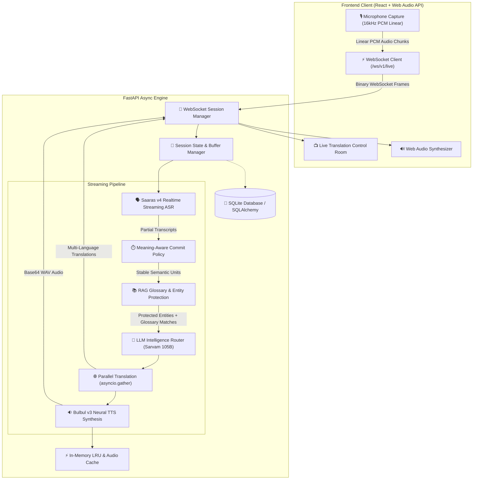

# IndicLive — System Architecture & Latency Engineering

## 1. High-Level Architectural Overview

IndicLive is a real-time, low-latency live speech translation and intelligence platform tailored for Indian multilingual contexts. It connects continuous microphone audio streams to speech recognition, semantic stabilization, entity protection, neural translation, and text-to-speech synthesis pipelines.

---

## 2. Component Responsibilities

### Frontend Layer (React + TypeScript + Vite)
- **Audio Worklet / ScriptProcessor**: Captures real-time browser audio at 16,000 Hz, 16-bit mono PCM.
- **WebSocket Manager**: Maintains resilient bi-directional streaming, heartbeats, and auto-reconnects.
- **Control Room UI**: Displays synchronized partial/final transcripts, multi-target translations, latency telemetry, and audio waveform visualizations.

### Backend Layer (FastAPI + AsyncIO)
- **WebSocket Session Handler** (`app/api/websocket.py`): Manages life cycles, stream concurrency, audio packet ingestion, and telemetry reporting.
- **Speech-to-Text Integration** (`app/ai/providers/sarvam/stt.py`): Streams raw audio chunks directly to Saaras v4 ASR.
- **Intelligent Commit Policy** (`app/ai/intelligence/commit_policy.py`): Eliminates word jitter and false commits by calculating stability thresholds and pause intervals.
- **RAG & Entity Protection** (`app/ai/intelligence/entity_protection.py`): Retrieves domain terminology and protects proper nouns, numbers, and brand terms.
- **LLM Intelligence Router** (`app/ai/intelligence/llm_router.py`): Employs Sarvam 105B for contextual ambiguity resolution, grammar polishing, and dialectal translation.
- **Parallel Translation Dispatcher**: Leverages `asyncio.gather()` to fan out translations across multiple target languages simultaneously.
- **Text-to-Speech Engine** (`app/ai/providers/sarvam/tts.py`): Converts finalized translations into synthesized Indic speech using Bulbul v3 with LRU caching.
